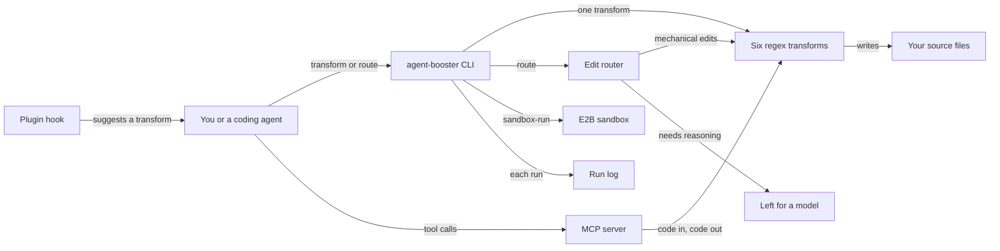

# How Agent Booster works

Agent Booster makes simple code edits without calling a language model.
It runs six fixed transforms over JavaScript and TypeScript files, such as turning `var` into `const` or removing `console` calls.
Each transform is a set of regular expressions, so it is deterministic, fast and free.
It is for coding agents, and the people who run them, who want to stop paying a model for mechanical edits.
A router decides which edits it can make itself and which still need a model.

## The parts

The CLI is [src/index.ts](../src/index.ts).
The six transforms are defined once, in [src/transforms.ts](../src/transforms.ts), and depend on nothing else.
The CLI, the router and the sandbox runner import them from there.
[src/mcp-server.ts](../src/mcp-server.ts) imports them too and offers one MCP tool per transform.
MCP, the Model Context Protocol, is the standard way an agent calls outside tools.
The MCP tools take code as text and return the changed code, so they never touch files.

[src/route.ts](../src/route.ts) is the router.
It dry-runs every transform, applies the ones that would change something, and lists the edits that need a model.
Today it flags two such edits: `.then()` chains that could become `async` and `await`, and function parameters that look untyped.
[src/sandbox-run.ts](../src/sandbox-run.ts) runs one transform inside an E2B sandbox, a short-lived virtual machine, for code you do not trust.
[src/run-log.ts](../src/run-log.ts) appends a record of each transform, `route`, `memory-search` and `sandbox-run` run to `logs/runs.jsonl`.
The plugin hook [hooks/suggest-transforms.cjs](../hooks/suggest-transforms.cjs) runs after an agent edits a file.
It counts leftover `console` calls and `var` declarations and names the transform that removes them.

## What happens when you run it

The main flow is `agent-booster <transform> <file or folder>`, for example `agent-booster var-to-const src/`.

1. [src/index.ts](../src/index.ts) reads the arguments. An unknown transform name stops the run and prints the valid names.
2. With `--stdin`, it reads code from standard input, prints the result and writes no file.
3. Otherwise it collects the files. A folder yields every `.ts`, `.tsx`, `.js`, `.jsx`, `.mjs` and `.cjs` file inside it. Dot folders, `node_modules` and `dist` are skipped.
4. For each file it runs the transform, which returns the new code, a change count and a description.
5. If the file changed and `--dry-run` is not set, it writes the file back.
6. [src/run-log.ts](../src/run-log.ts) appends one record with the transform, the target, the files changed, the change count and the time taken.
7. It prints a summary, or JSON with `--json`. `agent-booster log` shows the latest records.

`agent-booster route <file>` follows the five steps written at the top of [src/route.ts](../src/route.ts): inspect, classify, plan, execute and report.
The `--only` flag limits it to the transforms you name.

## Extending it

- **A new transform.** Follow [skills/add-a-transform/SKILL.md](../skills/add-a-transform/SKILL.md). Write a function shaped `(code, filename) => { code, changes, description }` that changes nothing when nothing matches. Put it, and its entry in the `transforms` map, in [src/transforms.ts](../src/transforms.ts) only: the CLI, the router and the sandbox runner read that map. Add a matching tool to `TOOLS` in [src/mcp-server.ts](../src/mcp-server.ts), because the golden evals compare the CLI with the MCP server. Update the help text in [src/index.ts](../src/index.ts) and the table in [README.md](../README.md). Golden case G16 fails if a transform is defined in a second file.
- **Tests for it.** Add a case to [src/\_\_tests\_\_/transforms.test.ts](../src/__tests__/transforms.test.ts), with a case where it must not fire. Add a golden case to [eval/golden.test.ts](../eval/golden.test.ts).
- **An edit that needs reasoning.** Do not write a regex for it. Add its name to `LLM_ONLY_TRANSFORMS` in [src/transforms.ts](../src/transforms.ts) and a detector to `detectLlmNeeds` in [src/route.ts](../src/route.ts).
- **A new command.** Add a branch to `main` in [src/index.ts](../src/index.ts), and call `recordRun` so it reaches the run log.
- **A new skill.** Add `skills/<name>/SKILL.md` and list it in [skills/README.md](../skills/README.md).

Then run `pnpm build`, `pnpm test` and `pnpm eval`.
If the eval pass count goes up, raise `evals_passed` in [eval/baseline.json](../eval/baseline.json).

## Questions

**Does it need an API key or cost money?**
Agent Booster is free and MIT licensed.
The transforms, the router and the MCP server call no model and need no key.
Only `sandbox-run` needs a key, `E2B_API_KEY`, and E2B is a paid service.

**Does any data leave the machine?**
Only with `sandbox-run`.
It writes the input file and a small driver script into an E2B sandbox, then reads the result back.
The run log stays in `logs/runs.jsonl` inside the package's own folder.
`memory-search` reads only this repository's own notes.

**How does it improve itself?**
[dsip.json](../dsip.json) puts it at level L2, which means a scheduled loop runs and writes proposals.
Every day [.github/workflows/improve.yml](../.github/workflows/improve.yml) runs [scripts/improve.mjs](../scripts/improve.mjs).
The script runs the golden evals and compares the pass count with [eval/baseline.json](../eval/baseline.json).
It lists failing cases and outdated dependencies, and on the CI runner it tries the in-range updates.
It writes a proposal to `logs/improve/latest.md`, uses no model and no secret, and merges nothing.
The workflow then opens one issue labelled `proposal`, or updates the one already open, so a person can review it.
It is not L3, because the loop does not change its own steps.

**How do I run its tests or evals?**
Run `pnpm install` and `pnpm build` first, because both suites run the built CLI.
`pnpm test` runs the end-to-end cases in [src/\_\_tests\_\_/](../src/__tests__/).
`pnpm eval` runs the golden cases in [eval/golden.test.ts](../eval/golden.test.ts).
[eval/README.md](../eval/README.md) says what they cover.

**What does it not do?**
It does not parse code into a syntax tree, so it cannot see scope or types.
Each transform matches text patterns. For example, `var-to-const` skips any name that looks reassigned.
It does not add types or rewrite promise chains. The router only flags those for a model.
It never calls a model itself.
